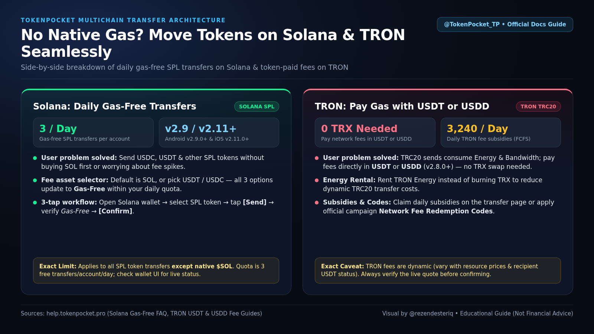
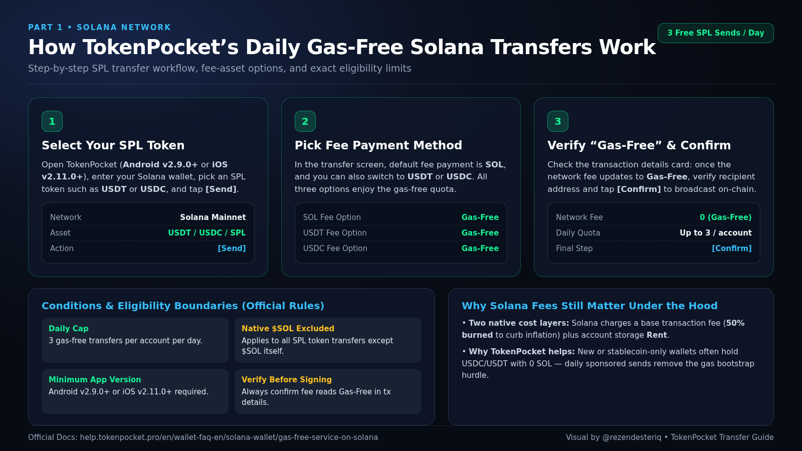
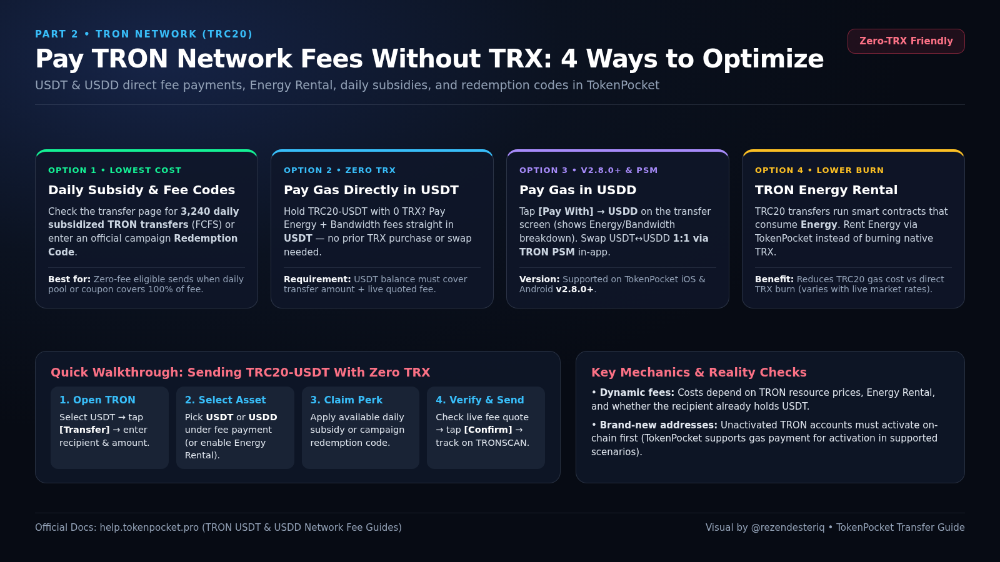

# TokenPocket Transfer Features Guide — Solana Daily Gas-Free & TRON Token-Paid Network Fees

- **Published X Thread (7 posts, English, 3 original visuals):** https://x.com/rezendesteriq/status/2125837285568451053
- **Author X Handle:** `@rezendesteriq` (following `@TokenPocket_TP`)
- **Official Video Tutorial Referenced:** https://x.com/TokenPocket_TP/status/2118610097987596552
- **Official Site:** https://tokenpocket.pro
- **Bounty:** Superteam Earn — *Create & Earn: Explore TokenPocket's Transfer Features* (500 USDC)

---

## Original Visual Diagrams Included in Thread

1. **Solana vs. TRON Zero-Native-Gas Overview:**  
   
2. **Solana Daily Gas-Free SPL Transfer Workflow & Limits:**  
   
3. **TRON Fee Optimization Matrix (USDT / USDD / Energy Rental / Subsidies):**  
   

---

## Full English Published Thread Draft (Verbatim)

### Post 1/7 — https://x.com/rezendesteriq/status/2125837285568451053

The biggest onboarding friction in crypto isn't creating a wallet—it's holding stablecoins with 0 native gas.

Here's a concise, docs-verified breakdown of how @TokenPocket_TP solves this on BOTH Solana and TRON (with exact rules & limits) 🧵👇

### Post 2/7 — https://x.com/rezendesteriq/status/2125837291369492898

1/ SOLANA — Daily Gas-Free SPL Transfers:
• Problem solved: move USDC/USDT/SPL tokens without buying SOL first.
• How (Android v2.9.0+ / iOS v2.11.0+): Solana wallet → SPL token → [Send] → pick SOL, USDT, or USDC fee mode → see 'Gas-Free' → [Confirm].

### Post 3/7 — https://x.com/rezendesteriq/status/2125837295555072229

2/ Exact Solana Conditions & Limits:
• Quota: 3 gas-free transfers per account per day.
• Scope: applies to all SPL token transfers EXCEPT native $SOL.
• Under the hood: Solana charges a base fee (50% burned) + account Rent; always verify 'Gas-Free' before signing.

### Post 4/7 — https://x.com/rezendesteriq/status/2125837301184094512

3/ TRON — Send TRC20-USDT With 0 TRX:
TRC20 sends run smart contracts using Bandwidth + Energy. Without TRX, users normally stall or burn costly TRX.

In @TokenPocket_TP, pay TRON fees directly in USDT—no TRX swap needed (just hold enough USDT for amount + live quote).

### Post 5/7 — https://x.com/rezendesteriq/status/2125837306448027847

4/ TRON — Pay Fees in USDD + 1:1 PSM Swap:
• On iOS & Android v2.8.0+, tap [Transfer] → [Pay With] → choose USDD to inspect Energy/Bandwidth details & confirm.
• Need USDD? TokenPocket supports TRON's PSM (Peg Stability Module) for 1:1 USDT ↔ USDD swaps via [Swap].

### Post 6/7 — https://x.com/rezendesteriq/status/2125837310449037599

5/ Extra TRON Savings & Reality Checks:
• Energy Rental: rent Energy instead of burning TRX.
• Daily Subsidies: 3,240 TRON subsidies/day (FCFS) + campaign Redemption Codes.
• Fees vary with network rates & recipient USDT status; brand-new TRON addresses need activation first.

### Post 7/7 — https://x.com/rezendesteriq/status/2125837314262024229

6/ Watch @TokenPocket_TP's official video tutorial:
https://x.com/TokenPocket_TP/status/2118610097987596552

Official wallet & docs: https://tokenpocket.pro
Educational guide from official docs for the TokenPocket community challenge—verify live fees in-app.

---

## Official Primary Sources Verified
- Solana Gas-Free Transfer Service: https://help.tokenpocket.pro/en/wallet-faq-en/solana-wallet/gas-free-service-on-solana
- Pay TRON Network Fees with USDT (No TRX Required): https://help.tokenpocket.pro/en/wallet-faq-en/tron-wallet/usdt-as-network-fee
- Pay TRON Network Fees with USDD (v2.8.0+ & TRON PSM): https://help.tokenpocket.pro/en/wallet-faq-en/tron-wallet/usdd-gas
- Official Video Tutorial on X: https://x.com/TokenPocket_TP/status/2118610097987596552
